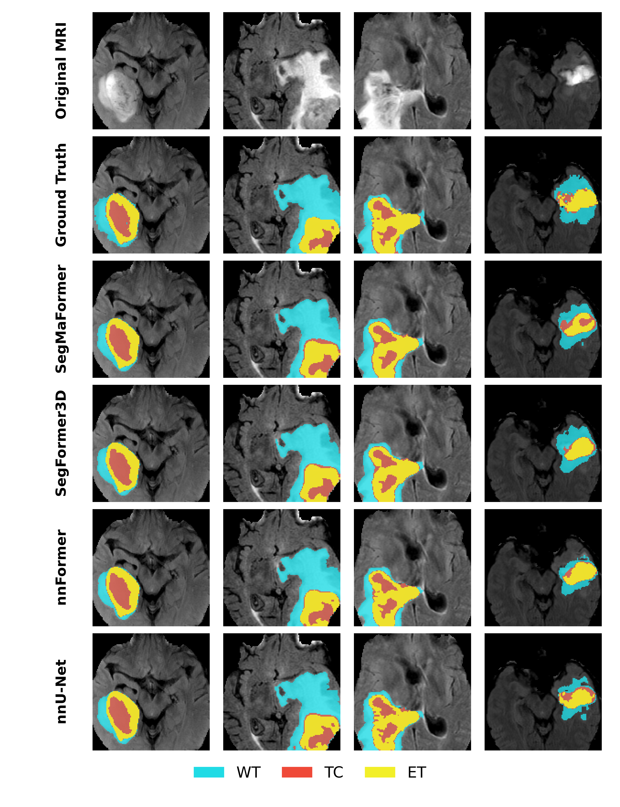
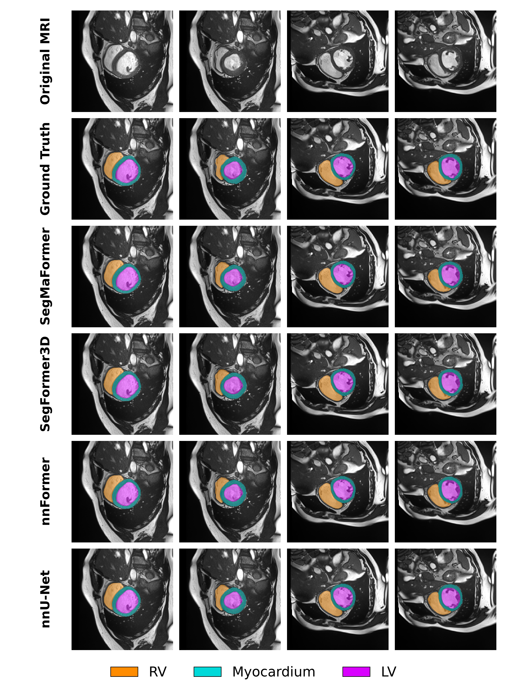
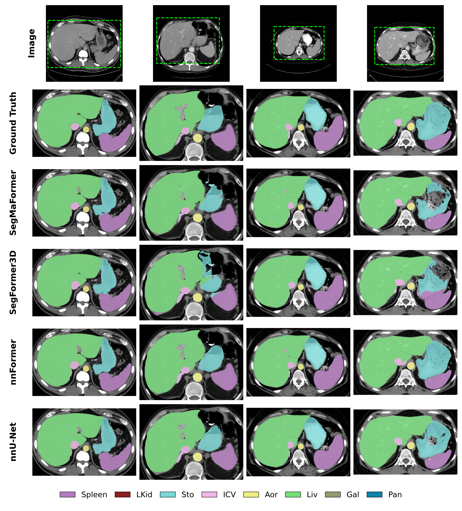

# SegMaFormer

SegMaFormer is a 3D medical image segmentation model integrated into nnU-Net v2.
This repository retains the `nnUNet-Custom` source structure and provides one
final SegMaFormer architecture, without custom ablation variants.

**Paper:** [*SegMaFormer: A Hybrid State-Space and Transformer Model for Efficient
3D Medical Image Segmentation*]by Duy D. Nguyen,
Phat T. Tran-Truong, and Xuan-Bach Le was accepted to the IEEE/CVF Winter
Conference on Applications of Computer Vision (WACV) 2027, Applications Track.

| Encoder stage | Mixer |
| --- | --- |
| Stage 1 | Mamba |
| Stage 2 | Gated Mamba + local 3D convolution |
| Stage 3 | Gated Mamba + local 3D convolution |
| Stage 4 | Self-attention |

3D RoPE is enabled at every patch embedding. The decoder combines all four
feature scales into a full-resolution segmentation output.

## Architecture figure


The diagram shows the encoder and feature-fusion decoder. Patch strides and
feature sizes vary by dataset configuration.


## 2. Installation

Create and activate a Python environment first. A Conda environment is recommended.

```bash
conda create -n segmaformer python=3.11 -y
conda activate segmaformer
```

This repo is currently configured around a CUDA 13 software stack. Make sure your NVIDIA driver and PyTorch installation are compatible with CUDA 13 before continuing.

Install a CUDA 13-compatible PyTorch build, then install the project from the cloned repository:

```bash
cd SegMaFormer
pip install --upgrade pip
pip install -e .
pip install -r requirements.txt
pip install --no-cache-dir --no-build-isolation mamba-ssm
```

The source folder in this release is `SegMaFormer`; use `cd nnUNet-Custom` instead if you named your clone `nnUNet-Custom`. The included `requirements.txt` is an environment snapshot and pins PyTorch 2.11.0 alongside CUDA 12 and CUDA 13 packages. Review its pins for your machine before installing it, especially if you installed PyTorch separately.

Optional CUDA sanity check:

```bash
python -c "import torch; print('torch', torch.__version__); print('cuda', torch.version.cuda); print('cuda available', torch.cuda.is_available())"
```

Check that the nnU-Net commands are available:

```bash
nnUNetv2_train -h
nnUNetv2_plan_and_preprocess -h
```

## Data preparation

Set the nnU-Net paths before conversion, preprocessing, training, or prediction:

```bash
export nnUNet_raw=/path/to/nnUNet_raw
export nnUNet_preprocessed=/path/to/nnUNet_preprocessed
export nnUNet_results=/path/to/nnUNet_results
export nnUNet_compile=false
```

Use the [nnU-Net dataset format](documentation/dataset_format.md):

```text
nnUNet_raw/
└── DatasetXXX_NAME/
    ├── imagesTr/
    ├── labelsTr/
    ├── imagesTs/          # Optional test images
    └── dataset.json
```

Image filenames include a channel suffix, such as `case001_0000.nii.gz`.
Corresponding label files use `case001.nii.gz`. See the
[path setup guide](documentation/setting_up_paths.md) for more details.

### ACDC

The [ACDC converter](nnunetv2/dataset_conversion/Dataset027_ACDC.py) expects
`training/` and `testing/` patient folders containing NIfTI images and `_gt` labels:

```bash
python nnunetv2/dataset_conversion/Dataset027_ACDC.py -i /path/to/ACDC -d 27
```

It creates the raw dataset and patient-level cross-validation splits.

### BraTS

The included [BraTS converter](nnunetv2/dataset_conversion/Dataset042_BraTS18.py)
is specific to preprocessed `*_modalities.pt` and `*_label.pt` inputs. Edit its
`pt_root` path before running it. For an original NIfTI release, prepare the
modalities and labels directly in nnU-Net format instead.

### BTCV

Prepare CT images, segmentation labels, and `dataset.json` in nnU-Net format.
Datasets are not bundled with this repository.

## Dataset configurations

All dataset trainers below use the same fixed stage layout and RoPE settings.
They retain the source project's dataset-specific configurations and losses.

| Dataset | Example ID | Trainer | Model config |
| --- | --- | --- | --- |
| BraTS | 42 | `SegMaFormerTrainer_BRATS` | [BRATS_config.yml](nnunetv2/training/nnUNetTrainer/network_architecture/configs/BRATS_config.yml) |
| ACDC | 27 | `SegMaFormerTrainer_ACDC` | [ACDC_config.yml](nnunetv2/training/nnUNetTrainer/network_architecture/configs/ACDC_config.yml) |
| BTCV | 1 | `SegMaFormerTrainer_BTCV` | [BTCV_config.yml](nnunetv2/training/nnUNetTrainer/network_architecture/configs/BTCV_config.yml) |
| Custom | Your ID | `SegMaFormerTrainer_Custom` | [Custom_config.yml](nnunetv2/training/nnUNetTrainer/network_architecture/configs/Custom_config.yml) |

Replace the example IDs with those of your datasets. BTCV uses the retained
fixed-stride settings; ACDC uses the isotropic settings. Input channels and
segmentation heads are taken from the dataset metadata. Model dimensions,
depths, and patch strides are defined in the linked YAML files.

## Preprocessing and training

Plan and preprocess each dataset once:

```bash
nnUNetv2_plan_and_preprocess -d 42 --verify_dataset_integrity
nnUNetv2_plan_and_preprocess -d 27 --verify_dataset_integrity
nnUNetv2_plan_and_preprocess -d 1 --verify_dataset_integrity
```

Train fold 0 with the corresponding dataset trainer:

```bash
# BraTS
nnUNetv2_train 42 3d_fullres 0 -tr SegMaFormerTrainer_BRATS

# ACDC
nnUNetv2_train 27 3d_fullres 0 -tr SegMaFormerTrainer_ACDC

# BTCV
nnUNetv2_train 1 3d_fullres 0 -tr SegMaFormerTrainer_BTCV
```

Use fold indices `0` through `4` for five-fold cross-validation. To select a GPU,
prefix a command with `CUDA_VISIBLE_DEVICES=0`.

Outputs for each fold are stored under:

```text
${nnUNet_results}/DatasetXXX_NAME/TRAINER__nnUNetPlans__3d_fullres/fold_0/
```

This directory contains training logs, checkpoints, and validation outputs.

## Validation and inference

Validate a trained BraTS fold:

```bash
nnUNetv2_train 42 3d_fullres 0 -tr SegMaFormerTrainer_BRATS --val
```

Predict using its best checkpoint:

```bash
nnUNetv2_predict \
  -i /path/to/test_images \
  -o /path/to/predictions \
  -d 42 -c 3d_fullres -f 0 \
  -tr SegMaFormerTrainer_BRATS \
  -chk checkpoint_best.pth
```

Use the same dataset ID, trainer, and fold used for training. Prediction inputs
must follow nnU-Net channel naming. Validation metrics are written to
`validation/summary.json` inside the fold directory.

## Qualitative results

These figures show historical SegMaFormer predictions beside ground truth and
reference models. They illustrate example cases, not aggregate performance
metrics. The reference models shown are not included in this cleaned repository.

### BraTS



### ACDC



### BTCV



## Upstream source

This repository builds on [nnU-Net v2 by MIC-DKFZ](https://github.com/MIC-DKFZ/nnUNet).
The original framework and its documentation are available in that repository.
See the included [Apache-2.0 license](LICENSE).
